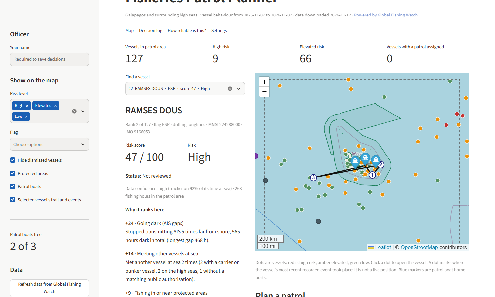
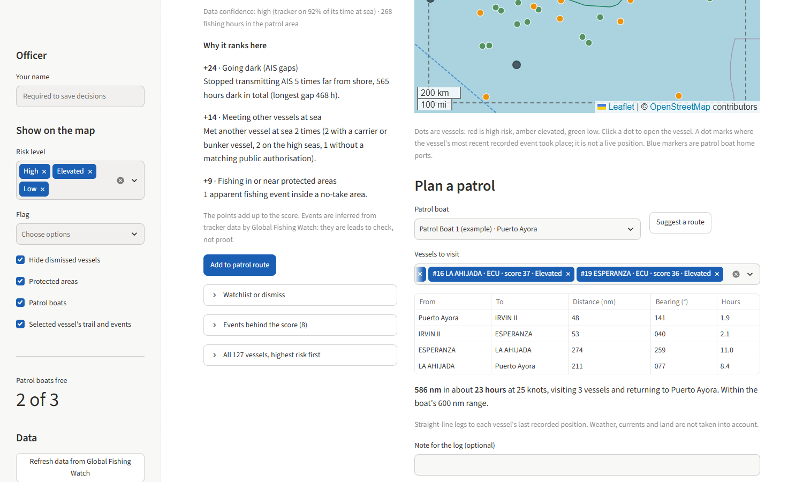

# Fisheries Patrol Planner

Ranks fishing vessels by illegal-fishing risk and plans patrols, using Global Fishing Watch data.



A fisheries officer usually has two or three patrol boats and a few hundred vessels in
their waters. This app helps decide which vessels to check first. It scores each vessel
on behaviour linked to illegal fishing, shows the reasons behind the score, draws a
patrol route, and keeps a record of every decision.

There is an 80-second walkthrough with captions in
[demo/fisheries-patrol-planner-demo.mp4](demo/fisheries-patrol-planner-demo.mp4).

## Contents

- [Quick start](#quick-start)
- [Using the app](#using-the-app)
- [How the score works](#how-the-score-works)
- [How accurate it is](#how-accurate-it-is)
- [Limits](#limits)
- [Development](#development)
- [Data sources and licences](#data-sources-and-licences)
- [More documentation](#more-documentation)
- [Contributing](#contributing)
- [Licence](#licence)

## Quick start

You need Windows 10 or 11 and Python 3.11 or newer. Google Chrome is used if it is
installed; otherwise the app opens in your default browser.

```
git clone https://github.com/TheMoshiach/fisheries-patrol-planner.git
cd fisheries-patrol-planner
.\run.bat
```

The first run creates a Python environment and installs the dependencies, which takes
a few minutes. After that the app starts in a few seconds and opens at
http://localhost:8501. Keep the console window open while you use the app, because
closing it stops the app. If the app is already running, `run.bat` opens it in the
browser again.

The repository includes a snapshot of real data up to 7 November 2026, so you see real
vessels straight away and do not need an API token to look around.

To start the app with a double-click, right-click `tools\create_shortcut.ps1` and
choose "Run with PowerShell". That puts a shortcut on your Desktop.

## Using the app

### Find a vessel

Each dot on the map is a fishing vessel that was active in the patrol area. Red dots
are high risk, amber are elevated and green are low. The outlined shapes are the marine
reserves being watched, the dashed box is the patrol area, and the blue markers are
patrol boats.

You can open a vessel by typing its name in the search box, ticking it in the ranked
list, or clicking its dot. The sidebar filters the map by risk level and flag.

### See why it ranks there

The panel under the search box shows the vessel's score and the reasons for it in
plain words, with the points each reason added. For example: "Stopped transmitting AIS
5 times far from shore, 565 hours dark in total." The events behind the score are
listed below the reasons.

On the map, the selected vessel gets a dashed trail joining the places it fished over
the last 90 days, plus markers where it switched its tracker off or met another ship.

### Plan a patrol



Pick a boat and add vessels to its route, or click "Suggest a route" to get the
highest-risk vessels that boat can reach and still get home. The route is drawn on the
map, and a table lists the distance, bearing and time of each leg. You get a warning if
the route is longer than the boat's range. "Save patrol" records the patrol, and
"Release" frees the boat when it is back.

You can also put a vessel on a watchlist or dismiss it with a reason. Dismissed vessels
drop off the map.

### Review decisions

The decision log lists every decision with the officer's name, the time, and the score
and rank the vessel had at that moment. Rows are only ever added. You can download the
log as a CSV file.

### Refresh the data and change settings

The Settings tab has a "Refresh data" button that downloads the newest data from Global
Fishing Watch and rebuilds the ranking. It takes 10 to 20 minutes and runs in the
background, and the page reloads when it finishes.

Refreshing needs a free API token. Copy `.env.example` to `.env`, then paste a token
from https://globalfishingwatch.org/our-apis/tokens after `GFW_API_TOKEN=`. The `.env`
file is ignored by git.

The same tab lets you edit your patrol boats, change how much each behaviour counts,
and move the patrol area by typing its edges or dragging a rectangle on a map. Boat and
weight changes apply at once. A new patrol area applies after the next refresh, because
it needs different data.

## How the score works

The score is a weighted sum of five behaviours over the last 12 months.

| Signal | What it looks at | Weight |
|---|---|---|
| Going dark | AIS gaps of 12 hours to 30 days that start 50 nm or more from shore | 0.30 |
| Meeting other vessels | Encounters at sea. Ones with a carrier or bunker vessel, or with no matching public authorisation, count double | 0.25 |
| Protected areas | Apparent fishing in no-take areas, fishing hours inside a watched reserve or within 12 nm of it, and AIS gaps inside a protected area | 0.25 |
| Unauthorised fishing | Apparent fishing in a regional fisheries body's waters with no known public authorisation | 0.15 |
| Flag changes | Changes of flag during the 12 months | 0.05 |

Each signal is turned into a strength between 0 and 1 with
`intensity / (intensity + half_point)`, so one behaviour cannot run up an unlimited
score. The strength is multiplied by the weight, and the five results add up to a score
out of 100. Because the score is a plain sum, it splits exactly into the points each
signal added, which is what the app shows as reasons.

The weights were set by hand before looking at any outcome and have not been tuned
since. Only five listed fishing vessels are available to test against, so fitting the
weights to them would overfit.

The default patrol area is the Galapagos and the surrounding high seas, with the
Galapagos and Hermandad marine reserves as the watched areas. The defaults are in
`config/settings.toml`, and anything changed in the app is saved to
`config/overrides.json`.

## How accurate it is

The ranking was tested against official lists of vessels caught fishing illegally,
published by regional fisheries bodies such as CCAMLR, IOTC and ICCAT. The scoring code
never sees those lists.

Listed vessels mostly stop broadcasting AIS, so each one was scored over its own last
year on AIS and compared with 30 vessels of the same class drawn at random from the
same months. The headline number is the chance that a listed vessel outranks a
comparison vessel from its group. A value of 0.5 is chance and 1.0 is perfect.

| Ranking | Fishing vessels (5 listed among 155) |
|---|---|
| Risk score | 0.97 (95% range 0.95 to 0.99) |
| Busiest vessels first | 0.42 (0.20 to 0.64) |
| Random order | 0.50 |

Within their groups of 31, the five listed fishing vessels ranked 1st, 2nd, 2nd, 2nd
and 3rd.

Read that result with three things in mind. Five vessels is very little evidence, and
three of them are sister ships from one fleet. Going dark on its own scores 0.95, so
the test mostly confirms that one signal and says little about the other four. And
none of the listed vessels is known to have been scored before it was listed, so the
test shows the score can separate listed vessels from ordinary ones and says nothing
about predicting a future listing.

The full method, the result for support vessels (which is not a fair test, for reasons
explained there) and the per-signal figures are in
[docs/evaluation.md](docs/evaluation.md).

## Limits

- Every event is an apparent event that Global Fishing Watch infers from AIS, so a
  high score is a reason to look at a vessel and is not evidence of an offence.
- Vessels that never transmit AIS are invisible, which includes most small boats.
- Positions are not live. A vessel's dot marks where its most recent recorded event
  happened, and the source publishes with a delay of a few days.
- The trail on the map joins the places a vessel fished. Actual tracks are not
  available to free API tokens.
- Patrol routes are straight lines to last known positions and ignore weather,
  currents and land.
- Many tuna vessels switch AIS off for commercial reasons, and some vessels fishing
  inside the Galapagos reserve are local boats licensed to be there. The public data
  cannot tell these apart from intruders. Use "Dismiss" for vessels you have ruled out.
- The patrol boats in `config/settings.toml` are examples. Replace them with yours in
  the Settings tab.

## Development

Run the tests:

```
.\test.bat
```

There are 95 tests. They cover the cleaning, feature and scoring steps, the accuracy
metrics, the decision log, the API client and the app.

The pipeline can also be run from a terminal with
`.venv\Scripts\python.exe -m patrol_planner <command>`:

| Command | What it does |
|---|---|
| `fetch` | Downloads real data and rebuilds everything. This is what the Refresh button runs |
| `build` | Reruns the pipeline on data already downloaded |
| `report` | Prints the accuracy tables |
| `sample` | Generates labelled synthetic data for trying the pipeline without a token |
| `status` | Shows which dataset is active |

Three scripts in `tools/` drive the real app in Chrome against a throwaway copy of the
data, so they never touch your decision log or settings. `browser_check.py` clicks
through every feature (18 checks), `make_demo.py` records the demo video, and
`make_screenshots.py` takes the screenshots on this page. They need two extra packages:

```
.venv\Scripts\python.exe -m pip install -e ".[demo]"
.venv\Scripts\python.exe -m playwright install ffmpeg
```

### How the code is organised

Data moves through four steps, and each step is a pure function from tables to tables:

```
raw (as received)  ->  clean (typed tables, stable ids)  ->  features  ->  scores
```

```
src/patrol_planner/        scoring, accuracy, decisions and data access (no UI code)
  schemas.py               table contracts: columns, types, primary keys, links
  transforms/clean.py      raw -> clean
  transforms/features.py   clean -> features
  transforms/scoring.py    features -> scores and plain-words reasons
  evaluation.py            accuracy against the IUU-list ground truth
  planning.py              ranking, patrol routes and suggested routes
  geo.py                   distances, bearings, outline thinning
  actions.py               officer decisions and the append-only log
  jobs.py                  background data refresh
  views.py                 read-only table joins for any front end
  sources/                 Global Fishing Watch client, ingestion, IUU list reader,
                           sample generator
app/streamlit_app.py       the app (display only)
config/settings.toml       default patrol area, weights, thresholds, example boats
data/real/                 snapshot of real cleaned tables, features, scores, evaluation
tests/                     95 tests
tools/                     launcher helpers, browser checks, demo and screenshot scripts
docs/                      evaluation write-up and screenshots
```

## Data sources and licences

Vessel activity, identity and indicators come from the
[Global Fishing Watch](https://globalfishingwatch.org) API, licensed CC BY-NC 4.0 for
non-commercial use. The snapshot in `data/real/` is derived from that data and carries
the same licence, so keep the attribution if you share it:

> Global Fishing Watch. 2026, updated daily. Fishing effort v5.0, fishing, encounter and
> AIS-gap events, vessel identity, 2020-01-01 to 2026-11-07. Data set accessed
> 2026-11-12 at https://globalfishingwatch.org/our-apis/.

The official IUU vessel lists of IOTC, CCSBT and CCAMLR are public documents. The code
reads them only to find IMO numbers to look up.

Protected-area boundaries come from the World Database on Protected Areas through
Global Fishing Watch. The outlines are downloaded during a refresh and stay on your
machine, because that database restricts redistribution. A fresh clone shows the
reserves after its first refresh.

The map background is © OpenStreetMap contributors.

## More documentation

- [docs/evaluation.md](docs/evaluation.md) has the full accuracy method and results.
- [DECISIONS.md](DECISIONS.md) lists each design choice with its reason.
- [AIP_MIGRATION.md](AIP_MIGRATION.md) is a step-by-step guide for moving the project
  into Palantir Foundry and AIP.

## Contributing

This is a personal project and is not set up for outside contributions. If you have
access to the repository and find a problem, open an issue.

## Licence

No licence has been chosen for the code, so all rights are reserved. The data snapshot
is covered by the Global Fishing Watch terms described above.
